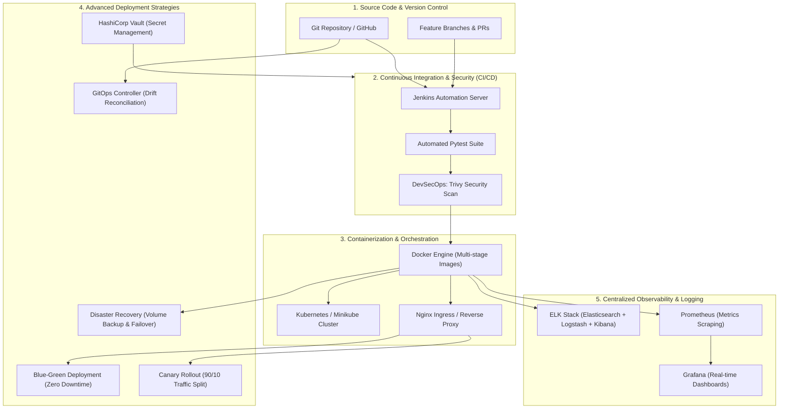

# DEVOPS AND AUTOMATION LAB (SEMESTER 7)
### Student ID: `2301420022` | Group: `Group 5` | Student: `Yatharth Chopra`

---

## 📌 OVERVIEW

This repository contains the complete practical solutions, configurations, automated pipelines, real execution screenshots, and submission-ready Word documents (`.docx`) for the **DevOps and Automation Laboratory Course**.

The labs cover the complete software delivery lifecycle from source version control to enterprise-grade continuous delivery, observability, and disaster resilience:
* **Lab 1:** Version Control, CI/CD Pipeline & Jenkins Automation
* **Lab 2:** Containerization with Docker & Kubernetes (Minikube) Orchestration
* **Lab 3:** Monitoring, Centralized Logging & DevSecOps
* **Lab 4:** Advanced Deployment Strategies & Enterprise DevOps

---

## 🏗️ HIGH-LEVEL ARCHITECTURE FLOW



---

## 📂 REPOSITORY DIRECTORY ARCHITECTURE

```
DevOps_and_Automation-Lab_2301420022/
│
├── README.md                                    # Root Documentation & Navigation
├── package.json                                 # Docx generation dependencies
├── .gitignore                                   # Ignore node_modules, pycache & temp files
│
├── Lab1/                                        # LAB 1: GIT & JENKINS AUTOMATION
│   ├── docs/                                    # Generated .docx Reports (Tasks 1-7)
│   ├── shots/                                   # Terminal PNG Screenshots
│   ├── tools/                                   # build_docs.js script
│   └── lab_1_devops.7z                          # Archive backup
│
├── Lab2/                                        # LAB 2: DOCKER & KUBERNETES ORCHESTRATION
│   ├── app/                                     # Flask Web Application v1.0
│   ├── app-v2/                                  # Flask Web Application v2.0
│   ├── compose-app/                             # Multi-container Docker Compose (App + Redis)
│   ├── k8s/                                     # Kubernetes Deployment & Service Manifests
│   ├── docs/                                    # Generated .docx Reports (Tasks 1-9)
│   ├── shots/                                   # Terminal PNG Screenshots
│   ├── tools/                                   # shot.py, make_terminal_shot.py, build_docs.js
│   ├── Jenkinsfile                              # Declarative CI/CD Pipeline
│   ├── cicd.ps1                                 # PowerShell Automated Deployment Script
│   └── lab_2_devops.7z                          # Archive backup
│
├── Lab3/                                        # LAB 3: MONITORING, LOGGING & DEVSECOPS
│   ├── app/                                     # Flask Web Application with /metrics
│   ├── ansible/                                 # Ansible Inventory & Playbook
│   ├── terraform/                               # Terraform Infrastructure as Code Manifests
│   ├── elk/                                     # ELK Stack Docker Compose & Logstash Config
│   ├── prometheus/                              # Prometheus & Grafana Docker Compose
│   ├── devsecops/                               # Trivy Security Scanner & Jenkinsfile
│   ├── feature-flags/                           # Feature Flag Engine & 17 Unit Tests
│   ├── docs/                                    # Generated .docx Reports (Tasks 1-7)
│   ├── shots/                                   # Terminal PNG Screenshots
│   └── tools/                                   # shot.py, make_terminal_shot.py, build_docs.js
│
├── Lab4/                                        # LAB 4: ADVANCED DEPLOYMENT STRATEGIES
│   ├── app/                                     # Stateful Flask Web Application v1.0
│   ├── app-v2/                                  # Stateful Flask Web Application v2.0
│   ├── blue-green/                              # Blue-Green Deployment & Nginx Switcher
│   ├── canary/                                  # Canary Deployment (90/10 Traffic Split)
│   ├── gitops/                                  # Declarative Manifest & Reconciler
│   ├── vault/                                   # HashiCorp Vault Secret Management
│   ├── disaster-recovery/                       # Automated Backup, Restore & Failover
│   ├── ci-testing/                              # Automated Pytest Suite & Pipeline Gates
│   ├── docs/                                    # Generated .docx Reports (Tasks 1-7)
│   ├── shots/                                   # Terminal PNG Screenshots
│   └── tools/                                   # shot.py, make_terminal_shot.py, build_docs.js
│
└── devops/                                      # Reference Lecture Notes & Course Slides
```

---

## 📑 LAB BREAKDOWN & DELIVERABLE REDIRECTS

### 🔹 [LAB 1: GIT & JENKINS AUTOMATION](Lab1/)

Demonstrates Git branching, merges, conflict resolution, Jenkins installation, freestyle projects, pipeline jobs, polling, and automated triggers.

| Task # | Task Title | Marks | Generated Document | Terminal Evidence |
|:---:|---|:---:|---|---|
| **Task 1** | Record All Commands | 5 | [Task1_Record_All_Commands.docx](Lab1/docs/Task1_Record_All_Commands.docx) | [git_graph.png](Lab1/shots/git_graph.png) |
| **Task 2** | CI/CD Workflow Report | 5 | [Task2_CICD_Workflow_Report.docx](Lab1/docs/Task2_CICD_Workflow_Report.docx) | [auto_trigger.png](Lab1/shots/auto_trigger.png) |
| **Task 3** | Automate Deployment with Jenkins | 5 | [Task3_Automate_Deployment_Jenkins.docx](Lab1/docs/Task3_Automate_Deployment_Jenkins.docx) | [build_step.png](Lab1/shots/build_step.png) |
| **Task 4** | Install & Configure Git and Jenkins | 5 | [Task4_Install_Configure_Git_Jenkins.docx](Lab1/docs/Task4_Install_Configure_Git_Jenkins.docx) | [jenkins_running.png](Lab1/shots/jenkins_running.png) |
| **Task 5** | Version Control with Git | 5 | [Task5_Version_Control_Git.docx](Lab1/docs/Task5_Version_Control_Git.docx) | [git_merge_ff.png](Lab1/shots/git_merge_ff.png) |
| **Task 6** | Basic Jenkins Pipeline | 5 | [Task6_Basic_Jenkins_Pipeline.docx](Lab1/docs/Task6_Basic_Jenkins_Pipeline.docx) | [pipeline_run.png](Lab1/shots/pipeline_run.png) |
| **Task 7** | Jenkinsfile Pipeline Stages | 5 | [Task7_Jenkinsfile_Pipeline_Stages.docx](Lab1/docs/Task7_Jenkinsfile_Pipeline_Stages.docx) | [scm_config.png](Lab1/shots/scm_config.png) |

---

### 🔹 [LAB 2: CONTAINERIZATION & KUBERNETES ORCHESTRATION](Lab2/)

Covers Docker image building, container management, storage persistence (volumes & bind mounts), custom bridge networks, multi-container Docker Compose with Redis, Minikube cluster deployment, rolling updates, rollbacks, and horizontal pod scaling.

| Task # | Task Title | Marks | Generated Document | Terminal Evidence |
|:---:|---|:---:|---|---|
| **Task 1** | Deploy Application to Kubernetes | 5 | [Task1_Deploy_to_Kubernetes_2301420022.docx](Lab2/docs/Task1_Deploy_to_Kubernetes_2301420022.docx) | [t1c_verify.png](Lab2/shots/t1c_verify.png) |
| **Task 2** | Kubernetes Deployment Strategies | 5 | [Task2_Kubernetes_Deployment_Strategies_2301420022.docx](Lab2/docs/Task2_Kubernetes_Deployment_Strategies_2301420022.docx) | [t2a_rolling.png](Lab2/shots/t2a_rolling.png) |
| **Task 3** | Containerization & Orchestration Report | 10 | [Task3_Containerization_Orchestration_Report_2301420022.docx](Lab2/docs/Task3_Containerization_Orchestration_Report_2301420022.docx) | [t2c_scaling.png](Lab2/shots/t2c_scaling.png) |
| **Task 4** | Containerize Application with Docker | 5 | [Task4_Containerize_with_Docker_2301420022.docx](Lab2/docs/Task4_Containerize_with_Docker_2301420022.docx) | [t4b_run.png](Lab2/shots/t4b_run.png) |
| **Task 5** | Manage Docker Containers & Images | 5 | [Task5_Manage_Docker_Containers_Images_2301420022.docx](Lab2/docs/Task5_Manage_Docker_Containers_Images_2301420022.docx) | [t5c_compose.png](Lab2/shots/t5c_compose.png) |
| **Task 6** | Docker Storage (Volumes & Bind Mounts) | 5 | [Task6_Docker_Storage_2301420022.docx](Lab2/docs/Task6_Docker_Storage_2301420022.docx) | [t6b_volume_bind.png](Lab2/shots/t6b_volume_bind.png) |
| **Task 7** | Docker Network (DNS & IP Routing) | 5 | [Task7_Docker_Network_2301420022.docx](Lab2/docs/Task7_Docker_Network_2301420022.docx) | [t7b_network_comm.png](Lab2/shots/t7b_network_comm.png) |
| **Task 8** | Configure Continuous Deployment | 5 | [Task8_Continuous_Deployment_2301420022.docx](Lab2/docs/Task8_Continuous_Deployment_2301420022.docx) | [t8b_cicd_run.png](Lab2/shots/t8b_cicd_run.png) |
| **Task 9** | Record All Tools Documentation | 5 | [Task9_All_Tools_Documentation_2301420022.docx](Lab2/docs/Task9_All_Tools_Documentation_2301420022.docx) | [t1a_cluster.png](Lab2/shots/t1a_cluster.png) |

---

### 🔹 [LAB 3: MONITORING, LOGGING & DEVSECOPS](Lab3/)

Covers automated provisioning with Ansible playbooks, Infrastructure as Code with Terraform, centralized logging with the ELK stack, DevSecOps vulnerability scanning with Aqua Security Trivy, Prometheus and Grafana observability, and runtime feature flags.

| Task # | Task Title | Marks | Generated Document | Terminal Evidence |
|:---:|---|:---:|---|---|
| **Task 1** | Configure Infrastructure & Automate Application | 5 | [Task1_Ansible_Infrastructure_Automation_2301420022.docx](Lab3/docs/Task1_Ansible_Infrastructure_Automation_2301420022.docx) | [t1_ansible.png](Lab3/shots/t1_ansible.png) |
| **Task 2** | Provision Scalable Infrastructure | 5 | [Task2_Terraform_IaC_2301420022.docx](Lab3/docs/Task2_Terraform_IaC_2301420022.docx) | [t2_terraform.png](Lab3/shots/t2_terraform.png) |
| **Task 3** | Implement Centralized Logging (ELK) | 5 | [Task3_ELK_Centralized_Logging_2301420022.docx](Lab3/docs/Task3_ELK_Centralized_Logging_2301420022.docx) | [t3_elk.png](Lab3/shots/t3_elk.png) |
| **Task 4** | Integrate Security into CI/CD (DevSecOps) | 5 | [Task4_DevSecOps_CICD_Security_2301420022.docx](Lab3/docs/Task4_DevSecOps_CICD_Security_2301420022.docx) | [t4_devsecops.png](Lab3/shots/t4_devsecops.png) |
| **Task 5** | Set Up Monitoring Using Prometheus & Grafana | 5 | [Task5_Prometheus_Grafana_Monitoring_2301420022.docx](Lab3/docs/Task5_Prometheus_Grafana_Monitoring_2301420022.docx) | [t5_prometheus.png](Lab3/shots/t5_prometheus.png) |
| **Task 6** | Implement Feature Flags & Unit Testing | 5 | [Task6_Feature_Flags_Testing_2301420022.docx](Lab3/docs/Task6_Feature_Flags_Testing_2301420022.docx) | [t6_flags.png](Lab3/shots/t6_flags.png) |
| **Task 7** | Monitoring, Logging & DevSecOps Report | 10 | [Task7_Monitoring_Logging_DevSecOps_Report_2301420022.docx](Lab3/docs/Task7_Monitoring_Logging_DevSecOps_Report_2301420022.docx) | All Lab 3 Figures |

---

### 🔹 [LAB 4: ADVANCED DEPLOYMENT STRATEGIES & ENTERPRISE DEVOPS](Lab4/)

Covers enterprise continuous delivery architectures: Docker volume snapshot disaster recovery with failover restore, CI/CD automated pytest gates, Blue-Green zero-downtime Nginx cutover, GitOps desired-state reconciliation, HashiCorp Vault encrypted secret management, and Canary 90/10 weighted rollouts.

| Task # | Task Title | Marks | Generated Document | Terminal Evidence |
|:---:|---|:---:|---|---|
| **Task 1** | Disaster Recovery Mechanism (Backup & Failover) | 5 | [Task1_Disaster_Recovery_Mechanism_2301420022.docx](Lab4/docs/Task1_Disaster_Recovery_Mechanism_2301420022.docx) | [t1_dr.png](Lab4/shots/t1_dr.png) |
| **Task 2** | Automated Testing within CI/CD Pipeline | 5 | [Task2_Automated_Testing_CICD_Pipeline_2301420022.docx](Lab4/docs/Task2_Automated_Testing_CICD_Pipeline_2301420022.docx) | [t2_testing.png](Lab4/shots/t2_testing.png) |
| **Task 3** | Blue-Green Deployment Strategy | 5 | [Task3_Blue_Green_Deployment_Strategy_2301420022.docx](Lab4/docs/Task3_Blue_Green_Deployment_Strategy_2301420022.docx) | [t3_bluegreen.png](Lab4/shots/t3_bluegreen.png) |
| **Task 4** | GitOps-Based Delivery & Reconciliation | 5 | [Task4_GitOps_Based_Delivery_2301420022.docx](Lab4/docs/Task4_GitOps_Based_Delivery_2301420022.docx) | [t4_gitops.png](Lab4/shots/t4_gitops.png) |
| **Task 5** | Advanced Deployment Strategies Report | 10 | [Task5_Advanced_Deployment_Strategies_Report_2301420022.docx](Lab4/docs/Task5_Advanced_Deployment_Strategies_Report_2301420022.docx) | All Lab 4 Figures |
| **Task 6** | Secret Management for the Pipeline (Vault) | 5 | [Task6_Secret_Management_Pipeline_2301420022.docx](Lab4/docs/Task6_Secret_Management_Pipeline_2301420022.docx) | [t5_vault.png](Lab4/shots/t5_vault.png) |
| **Task 7** | Canary Deployment Strategy (Weighted Routing) | 5 | [Task7_Canary_Deployment_Strategy_2301420022.docx](Lab4/docs/Task7_Canary_Deployment_Strategy_2301420022.docx) | [t6_canary.png](Lab4/shots/t6_canary.png) |

---

## 🚀 HOW TO RUN AND VERIFY LOCALLY

### 1. Prerequisites
Ensure you have the following installed on your machine:
* [Docker Desktop](https://www.docker.com/) (with Docker Compose enabled)
* [Python 3.10+](https://www.python.org/)
* [Node.js 18+](https://nodejs.org/)
* [Git](https://git-scm.com/)

### 2. Verify Deployments
* **Blue-Green Deployment (Lab 4):**
  ```powershell
  cd Lab4/blue-green
  docker compose up -d
  curl http://localhost:5300/
  ```
* **Canary Deployment (Lab 4):**
  ```powershell
  cd Lab4/canary
  docker compose up -d
  1..10 | ForEach-Object { curl http://localhost:5400/ }
  ```
* **GitOps Reconciliation (Lab 4):**
  ```powershell
  cd Lab4
  python gitops/deploy.py
  ```
* **Feature Flags Unit Tests (Lab 3):**
  ```powershell
  cd Lab3
  python feature-flags/test_flags.py
  ```
* **CI Quality Gate Automated Tests (Lab 4):**
  ```powershell
  cd Lab4/ci-testing
  python -m pytest test_app.py -v
  ```

### 3. Rebuilding Documentation Files
All `.docx` files can be programmatically recompiled at any time:
```powershell
npm run build:lab3
npm run build:lab4
```

---

## 👨‍🎓 AUTHOR & SUBMISSION DETAILS
* **Student Name:** Yatharth Chopra
* **Student ID / Roll No:** `2301420022`
* **Course:** DevOps & Automation Laboratory
* **Semester:** 7th Semester
* **Batch / Group:** Group 5
* **Repository:** [DevOps_and_Automation-Lab_2301420022](https://github.com/yatharthchopra2424/DevOps_and_Automation-Lab_2301420022)
